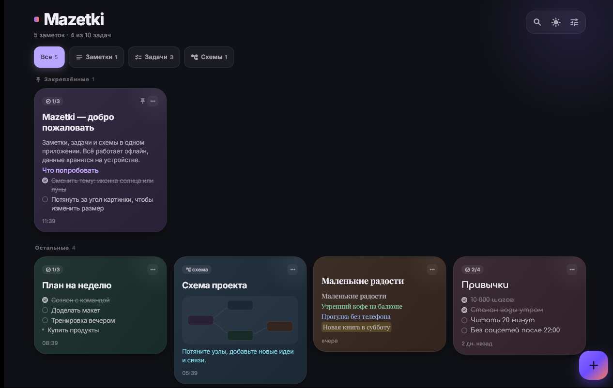
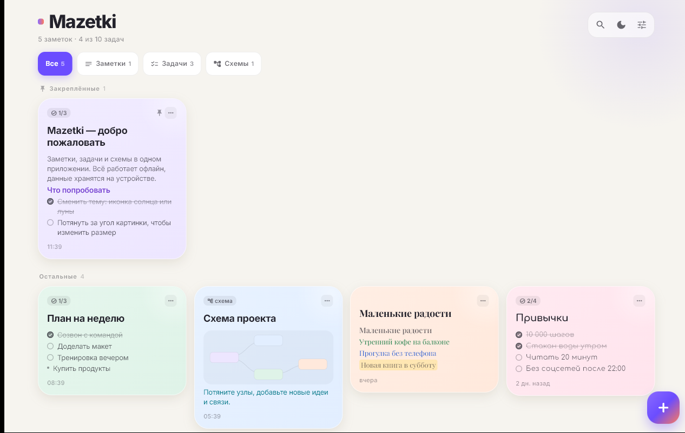
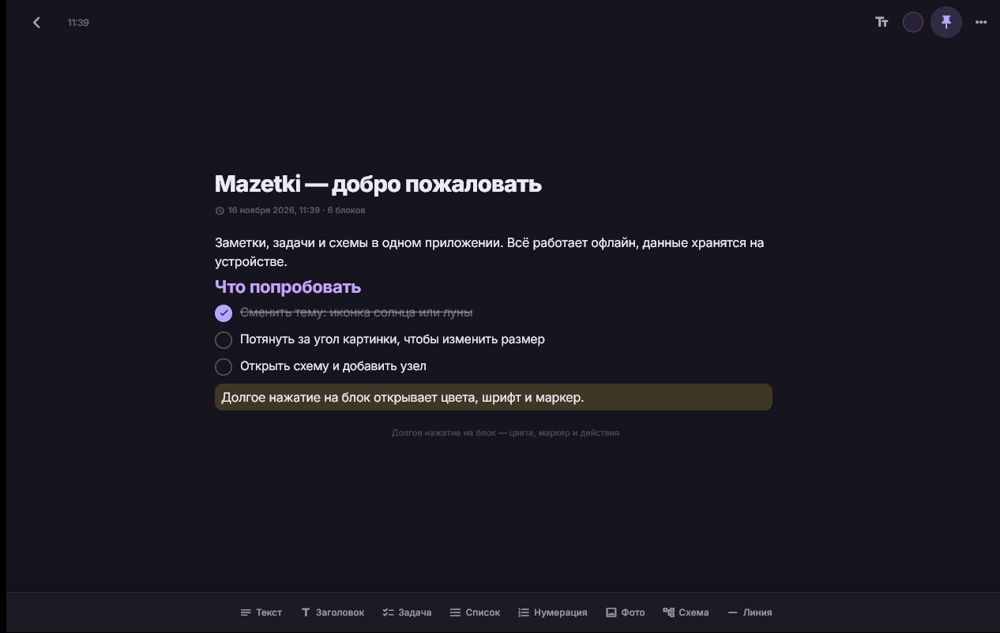
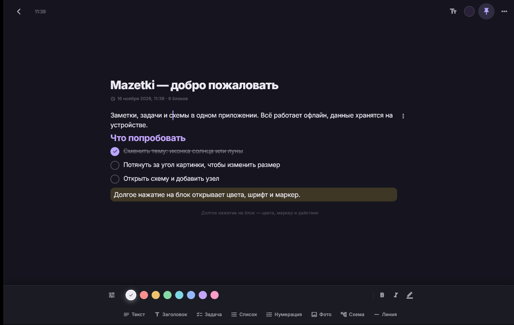
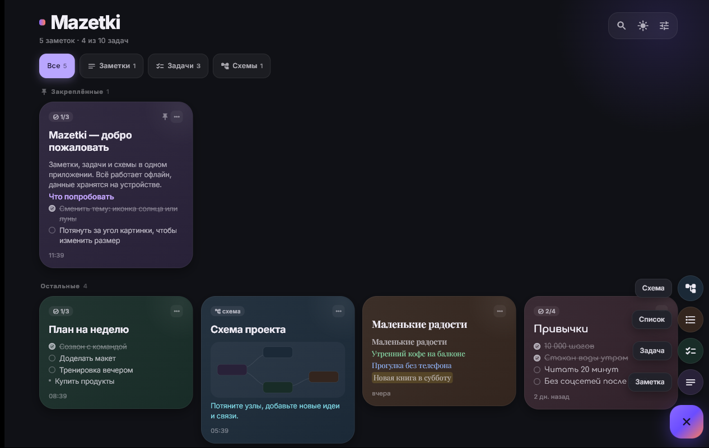
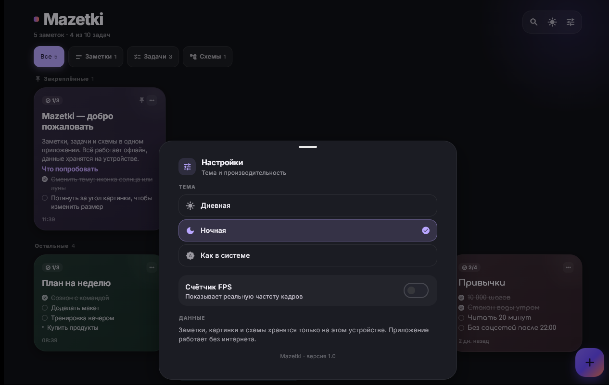
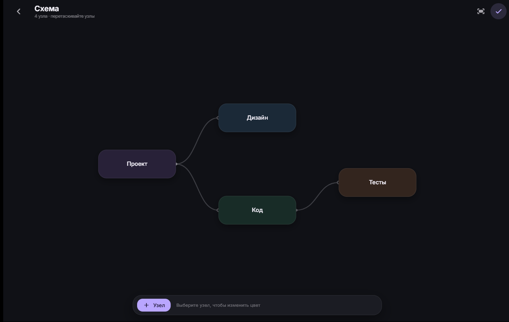

# Mazetki

**Заметки, задачи и схемы — красиво, быстро, офлайн.**

[](https://flutter.dev)
[](https://dart.dev)
[](#сборка-и-запуск)
[](#приватность)
[](#производительность)

<p align="center">
  
</p>

**Mazetki** — приложение для заметок, вдохновлённое «Поко»: цветные карточки с плавными
анимациями, редактор из блоков, задачи, списки, картинки с изменением размера
перетаскиванием и полноэкранный редактор схем. Всё работает без интернета,
данные остаются на устройстве.

> Написано на Flutter · Material 3 · собственные палитры и анимации

---

## Скриншоты

| Главный экран · ночная тема | Главный экран · дневная тема |
| :---: | :---: |
| [](screenshots/01-home-dark.png) | [](screenshots/02-home-light.png) |

| Редактор заметки | Форматирование блока |
| :---: | :---: |
| [](screenshots/04-editor.png) | [](screenshots/05-editor-format.png) |

| Меню создания | Настройки |
| :---: | :---: |
| [](screenshots/03-create-menu.png) | [](screenshots/06-settings.png) |

<p align="center">
  
</p>

<p align="center"><i>Редактор схем: цветные узлы, связи-кривые, зум и перетаскивание</i></p>

---

## Возможности

### 🗂 Карточки-заметки
- Masonry-сетка с карточками разной высоты и 8 цветовыми палитрами.
- Плавное появление при запуске, «схлопывание» при скрытии, hover-анимации.
- Закреплённые заметки — отдельной секцией сверху.
- Превью содержимого: текст, задачи, картинка, мини-схема.

### 🌗 Темы
- Дневная, ночная и «как в системе».
- Переключение одним тапом в шапке или в настройках, с анимированным переходом.
- Цвет заметки задаёт фон карточки и мягкий оттенок фона редактора.

### ✍️ Редактор из блоков
- Текст, заголовок, задача, список, нумерация, картинка, схема, разделитель.
- Долгое нажатие или «⋮» у блока — цвет текста, маркер, жирный/курсив,
  перемещение, дублирование, удаление.
- Панель форматирования появляется под выбранным блоком.
- Четыре шрифта: **Интер**, **Классика** (Playfair Display), **Округлый** (Comfortaa),
  **Моно** (JetBrains Mono).
- Автосохранение с дебаунсом; пустая заметка удаляется при выходе.

### ✅ Задачи и списки
- Кружки-галочки с анимацией, зачёркивание выполненного.
- Счётчики «сделано / всего» на карточках и в шапке приложения.

### 🖼 Картинки
- Добавление из файловой системы, замена одним тапом.
- Ширина меняется перетаскиванием картинки или углового маркера.
- Двойной тап — на всю ширину. Пропорции сохраняются, превью кэшируются.

### 🧠 Схемы
- Полноэкранный редактор: перетаскивание узлов, связи-кривые, зум и панорамирование.
- Добавление дочерних узлов, переименование двойным тапом, 7 цветов.
- Мини-превью схемы прямо в карточке и в блоке заметки.

### 🔎 Поиск и порядок
- Поиск по названию, тексту блоков и подписям узлов схем.
- Фильтры: все, заметки, задачи, схемы — с живыми счётчиками.
- Секция «Скрытые»: восстановление, удаление и снекбар «Вернуть».

### ⚙️ Настройки
- Тема и системная тема.
- Счётчик FPS — реальная частота кадров движка.

---

## Жесты и действия

| Действие | Результат |
| --- | --- |
| Тап по карточке | Открыть заметку |
| Долгое нажатие на карточку | Меню заметки: цвет, закрепить, дублировать, скрыть, удалить |
| Тап по блоку в редакторе | Панель форматирования |
| Долгое нажатие / «⋮» у блока | Цвет, маркер, жирный/курсив, порядок, действия |
| Перетаскивание картинки вбок | Изменение ширины |
| Двойной тап по картинке | На всю ширину |
| Двойной тап по узлу схемы | Переименовать |
| Тап «+» на узле схемы | Добавить дочерний узел |
| Долгое нажатие на узел схемы | Меню узла |

---

## Технологии

| Слой | Реализация |
| --- | --- |
| UI | Flutter 3.41 · Material 3 · собственные палитры и типографика |
| Состояние | `ChangeNotifier` + `InheritedNotifier`, отдельный `ValueNotifier` для темы |
| Хранение | JSON-файлы в папке приложения, картинки — отдельными файлами |
| Сетка | `flutter_staggered_grid_view` (ленивый masonry) |
| Файлы и пути | `file_picker`, `path_provider` |
| Рендер схем | `CustomPainter` для связей и превью, `InteractiveViewer` для зума/пана |

---

## Сборка и запуск

Нужен [Flutter](https://flutter.dev) 3.41+ (Dart 3.11+).

```bash
git clone <адрес-репозитория>
cd mazetki
flutter pub get

# Запуск
flutter run -d windows      # Windows
flutter run -d android      # Android
```

Готовые сборки:

```bash
flutter build windows --release   # build\windows\x64\runner\Release\mazetki.exe
flutter build apk --release       # build\app\outputs\flutter-apk\app-release.apk
```

iOS собирается на macOS: `flutter build ios --release`.

Проверка качества:

```bash
flutter analyze   # без замечаний
flutter test      # модель + UI smoke-тесты (390×844 и 1280×860)
```

---

## Структура проекта

```
lib/
├─ main.dart                   точка входа, инициализация хранилища
├─ app.dart                    MaterialApp, темы, анимация смены темы
├─ theme.dart                  Material 3 тема, типографика, шиты, снекбары
├─ models/
│  ├─ note.dart                заметка и блоки (текст, задачи, картинки, схемы)
│  └─ diagram.dart             узлы и связи схемы
├─ screens/
│  ├─ home_screen.dart         карточки, фильтры, поиск, скрытые, настройки
│  ├─ note_editor_screen.dart  редактор блоков, панель форматирования
│  └─ diagram_screen.dart      полноэкранный редактор схемы
├─ state/notes_store.dart      CRUD, тема, FPS, дебаунс сохранения
├─ services/
│  ├─ storage.dart             JSON и картинки в папке приложения
│  └─ demo_data.dart           демо-заметки при первом запуске
├─ widgets/                    карточка, FAB, картинка, мини-схема, FPS, UI-хелперы
└─ utils/                      палитры, шрифты, форматирование дат
```

---

## Приватность

Нет аккаунтов, аналитики и сетевых запросов. Заметки, картинки и настройки
лежат локально:

```
Windows:  %APPDATA%\com.mazetki\mazetki\
Android:  /data/user/0/com.mazetki.mazetki/files/
iOS:      <Application Support>/

notes.json
settings.json
images/
```

При первом запуске создаются демонстрационные заметки — их можно удалить.

---

## Производительность

- Текст в редакторе не перестраивает главный экран (структурные изменения — отдельно).
- Сохранение на диск с дебаунсом 550 мс, запись через временный файл.
- Картинки декодируются с `cacheWidth` под фактический размер на экране.
- Ленивая masonry-сетка: строятся только видимые карточки.
- Анимации короткие, на `easeOutCubic`, с учётом системной настройки «уменьшить движение».
- Встроенный счётчик FPS для проверки 120 Гц-дисплеев.

---

## Планы

- [ ] Экспорт заметки в Markdown и PDF
- [ ] Напоминания и повторяющиеся задачи
- [ ] Виджеты для домашнего экрана Android/iOS
- [ ] Синхронизация между устройствами (опционально, с шифрованием)
- [ ] Рисование от руки поверх схем

---

## Лицензия

Проект распространяется по лицензии MIT — см. файл [LICENSE](LICENSE).

<p align="center"><sub>Сделано с Flutter · Mazetki 1.0</sub></p>
